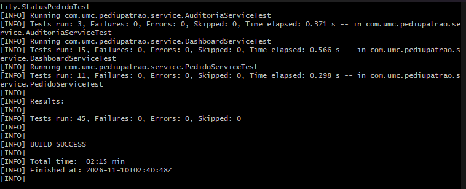
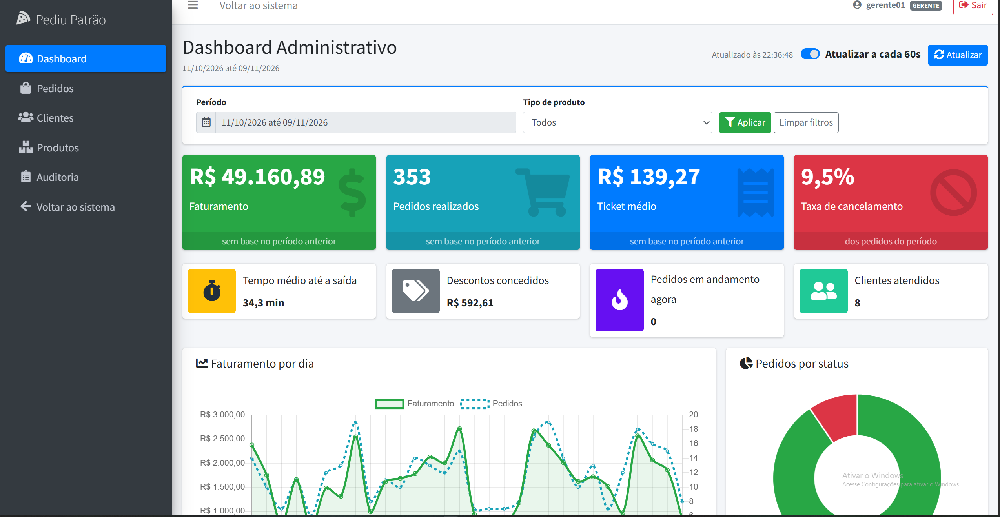
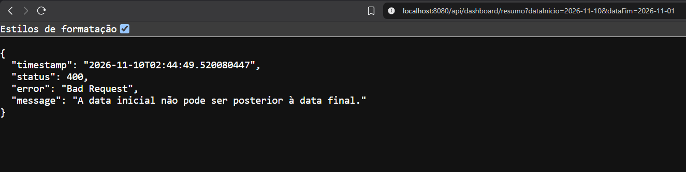
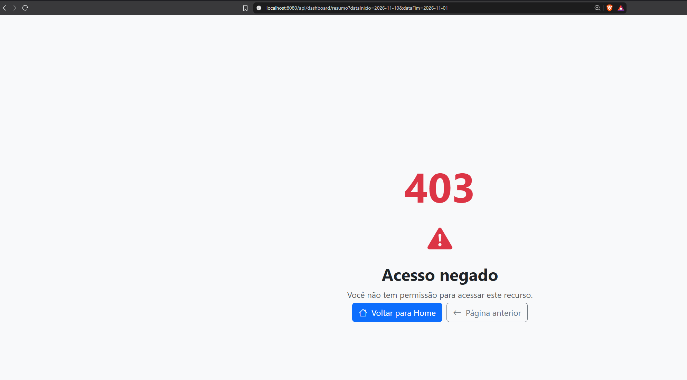

# PediuPatrão

Sistema de pedidos para pizzaria, evoluído a partir do projeto base fornecido na disciplina, com controle de acesso por perfil, fluxo controlado de pedidos, descontos e cancelamentos exclusivos do gerente, auditoria e um dashboard administrativo.

Tecnologias: Java 21, Spring Boot 3.4, Spring Security 6, Spring Data MongoDB, Thymeleaf, AdminLTE 3.2, Chart.js, Docker Compose.

| | |
|---|---|
| Autor | Leonardo Valdir Silva |
| RGM | 11232100617 |
| Turma | 8B, Engenharia de Software, Universidade de Mogi das Cruzes |

## Vídeo de apresentação do Dashboard

**[Assistir no YouTube](https://www.youtube.com/watch?v=5WwISiamT6Q)**: funcionamento do dashboard (indicadores, gráficos, filtros, atualização, integração com a API e restrição de acesso) e justificativa das decisões de análise e projeto.

Vídeo da entrega anterior (perfis, pedidos e auditoria): [assistir no YouTube](https://youtu.be/3HIMAxmc-Io).

## Sumário

**Dashboard Administrativo (entrega atual)**

1. [Visão geral](#1-visão-geral)
2. [Requisitos funcionais](#2-requisitos-funcionais)
3. [Requisitos não funcionais](#3-requisitos-não-funcionais)
4. [Regras de negócio](#4-regras-de-negócio)
5. [Decisões de análise e projeto](#5-decisões-de-análise-e-projeto)
6. [Documentação dos endpoints](#6-documentação-dos-endpoints)
7. [Evidências de testes](#7-evidências-de-testes)
8. [Branch e arquivos do incremento](#8-branch-e-arquivos-do-incremento)

**Projeto**

9. [Como executar](#9-como-executar)
10. [Usuários e permissões](#10-usuários-e-permissões)
11. [Demais endpoints da API](#11-demais-endpoints-da-api)
12. [Entrega anterior: perfis, pedidos e auditoria](#12-entrega-anterior-perfis-pedidos-e-auditoria)

---

## 1. Visão geral

O dashboard (`/dashboard`) permite ao responsável pelo estabelecimento acompanhar as vendas, a situação dos pedidos e as tendências da operação. Acesso restrito aos perfis **ADMIN** e **GERENTE**.

- **API REST** (`DashboardApiController` e `DashboardService`): calcula os indicadores a partir dos pedidos gravados no MongoDB e os devolve em JSON.
- **Tela** (`dashboard.html`, AdminLTE 3.2 e Chart.js): consome a API por `fetch` e exibe indicadores, gráficos, ranking e filtros.

```
Navegador (dashboard.html)
   │  GET /api/dashboard/...?dataInicio=&dataFim=&tipoProduto=
   ▼
SecurityConfig - ADMIN ou GERENTE? se não: 401 ou 403
   ▼
DashboardApiController ─ repassa os parâmetros
   ▼
DashboardService ─ valida o filtro (400 se inválido), consulta o MongoDB
   │                 pelo período (índice em criadoEm) e calcula com BigDecimal
   ▼
DTOs de resposta (records) ── JSON para a tela
```

## 2. Requisitos funcionais

| Código | Requisito | Como foi atendido | Critério de aceite |
|---|---|---|---|
| RF01 | Indicadores gerais | Oito indicadores em cartões: faturamento, pedidos realizados, ticket médio e taxa de cancelamento (com variação em relação ao período anterior), tempo médio até a saída, descontos concedidos, pedidos em andamento e clientes atendidos. Endpoint `resumo` | Ticket médio igual ao faturamento dividido pelos pedidos realizados |
| RF02 | Análise de vendas | Linha do faturamento por dia, com a quantidade de pedidos em um segundo eixo, e barras de pedidos por hora, com o pico destacado. Endpoints `vendas-por-dia` e `pedidos-por-hora` | Todos os dias do período aparecem, inclusive os sem venda |
| RF03 | Situação dos pedidos | Rosca com a distribuição por status, com cor fixa por status. Endpoint `pedidos-por-status` | Todos os status do fluxo, na ordem, inclusive os zerados |
| RF04 | Produtos mais vendidos | Ranking em barras horizontais e tabela, com unidades e receita. Endpoint `produtos-mais-vendidos` | Ordenado por unidades (desempate pela receita), sem cancelados, respeitando o limite |
| RF05 | Filtros | Período com atalhos (Hoje, Últimos 7 dias, Últimos 30 dias, Este mês, Mês passado, Personalizado) e tipo de produto, preenchido pelo endpoint `tipos-produto` | Ao aplicar, todos os componentes recarregam com o mesmo filtro |
| RF06 | Integração com a API | A tela não recebe dados pelo Thymeleaf: as cinco consultas são feitas por `fetch`, em paralelo (`Promise.all`), e cada uma consulta o MongoDB | Um pedido novo aparece ao atualizar, sem reiniciar a aplicação |
| RF07 | Atualização e tratamento | Botão Atualizar, atualização automática a cada 60 s (pausada com a aba em segundo plano), horário da última atualização, carregamento por gráfico, mensagem de período vazio, alerta com o erro da API e retorno ao login se a sessão expirar | Período sem pedidos: indicadores zerados, sem divisão por zero |

## 3. Requisitos não funcionais

| Código | Requisito | Como foi atendido |
|---|---|---|
| RNF01 | Segurança: só ADMIN e GERENTE acessam | Regra de URL no `SecurityConfig` e `@PreAuthorize` no `DashboardService` |
| RNF02 | Segurança: API sem sessão não redireciona | Resposta `401` |
| RNF03 | Segurança: dados do banco não viram HTML | Tabela do ranking montada com `textContent` |
| RNF04 | Desempenho: consultas por período eficientes | Índice em `criadoEm` na coleção `pedidos` |
| RNF05 | Desempenho: volume limitado | Período máximo de 366 dias e ranking com até 20 posições |
| RNF06 | Precisão monetária | `BigDecimal` com arredondamento `HALF_UP` em 2 casas |
| RNF07 | Usabilidade: interface padronizada e responsiva | Componentes do AdminLTE e grid do Bootstrap 4 |
| RNF08 | Usabilidade: padrão brasileiro | Moeda e números com `Intl.NumberFormat('pt-BR')`, datas em DD/MM/AAAA |
| RNF09 | Disponibilidade sem CDN | AdminLTE, Chart.js, moment e daterangepicker servidos pela própria aplicação |
| RNF10 | Manutenibilidade | Controller (HTTP), service (regras) e DTOs de resposta separados |
| RNF11 | Testabilidade | Cálculo isolado e relógio injetável (`Clock`), testados sem banco |
| RNF12 | Compatibilidade | Template próprio para o dashboard, sem alterar as telas existentes |

## 4. Regras de negócio

| Código | Regra |
|---|---|
| RN-D01 | **Pedido realizado**: todo pedido do período que não foi cancelado |
| RN-D02 | **Faturamento**: soma do total (já com desconto) dos pedidos realizados |
| RN-D03 | **Ticket médio**: faturamento dividido pelos pedidos realizados; zero sem pedidos |
| RN-D04 | **Taxa de cancelamento**: cancelados sobre o total de pedidos do período, em percentual |
| RN-D05 | **Tempo médio até a saída**: média em minutos entre a entrada e a saída, só dos pedidos que já saíram |
| RN-D06 | **Descontos concedidos**: soma dos descontos dos pedidos realizados |
| RN-D07 | **Clientes atendidos**: clientes distintos entre os pedidos realizados |
| RN-D08 | **Pedidos em andamento**: retrato do momento (Recebido, Em preparação, Pronto, Saiu para entrega), independente do período |
| RN-D09 | **Variação**: compara com o período anterior de mesma duração; fica vazia quando não há base de comparação |
| RN-D10 | **Ranking**: unidades vendidas e receita bruta dos itens, sem pedidos cancelados |
| RN-D11 | **Filtro por tipo**: pedidos com ao menos um item do tipo; o ranking mostra só produtos do tipo |
| RN-D12 | **Período padrão**: últimos 30 dias; data inicial não pode ser posterior à final; máximo de 366 dias |

## 5. Decisões de análise e projeto

**Indicadores e gráficos escolhidos**

| Componente | Por que foi escolhido |
|---|---|
| Faturamento, pedidos e ticket médio | Respondem quanto foi vendido, em que volume e quanto cada cliente gasta, em média, por pedido. A variação em relação ao período anterior mostra a tendência |
| Taxa de cancelamento | Indica falhas na operação (área de entrega, falta de produto, demora) |
| Tempo médio até a saída e pedidos em andamento | Medem a agilidade e a carga atual da cozinha |
| Descontos concedidos | Controle do valor que deixou de ser recebido, já que só o gerente concede desconto |
| Linha de faturamento por dia | Formato adequado para evolução no tempo; evidencia os picos de fim de semana |
| Rosca de pedidos por status | Mostra a proporção de cada etapa; acúmulo em um status indica gargalo |
| Barras por hora do dia | Compara as horas e destaca o pico, orientando a escala de equipe e entregadores |
| Ranking de produtos com receita | O mais vendido nem sempre é o que mais fatura; orienta cardápio, estoque e promoções |

**Decisões técnicas**

| Decisão | Alternativa | Justificativa |
|---|---|---|
| Endpoints separados por recurso | Um endpoint único | Contratos simples, reutilizáveis e testáveis isoladamente; a tela os chama em paralelo |
| MongoDB filtra o período e o service calcula em Java | Agregação `$sum` no MongoDB | O Spring Data grava `BigDecimal` como texto, então a soma pelo banco não funcionaria e perderia centavos |
| Tipo do produto copiado para o item do pedido | Cruzar `pedidos` e `produtos` a cada consulta | Mesmo padrão do nome e do preço: preserva o histórico e evita junções |
| Dias e horas sem pedidos devolvidos com zero | Devolver só os dias com venda | O gráfico não pula datas e a tela não completa lacunas |
| Validação dos filtros no service, com `400` | Validar só na tela | A regra vale para qualquer cliente da API |
| AdminLTE em template próprio | Migrar todo o sistema | O AdminLTE 3.2 usa Bootstrap 4 e as telas existentes usam Bootstrap 5 |
| Consulta periódica a cada 60 s | WebSocket ou Server-Sent Events | Atende ao requisito sem infraestrutura adicional |
| Seed de demonstração opcional (`SEED_DEMO`) | Cadastrar pedidos manualmente | 30 dias de dados realistas e reprodutíveis (semente fixa), desligado por padrão |

## 6. Documentação dos endpoints

| Item | Valor |
|---|---|
| URL base | `http://localhost:8080/api/dashboard` |
| Método | `GET` (somente leitura) |
| Autenticação | Sessão do login (cookie `JSESSIONID`); no navegador, basta estar logado |
| Perfis | ADMIN, GERENTE |

**Parâmetros de filtro** (todos os endpoints, exceto `tipos-produto`):

| Parâmetro | Tipo | Padrão | Descrição |
|---|---|---|---|
| `dataInicio` | `AAAA-MM-DD` | 29 dias antes de `dataFim` | Primeiro dia do período |
| `dataFim` | `AAAA-MM-DD` | Hoje | Último dia do período |
| `tipoProduto` | texto | Todos | `Pizza`, `Bebida` ou `Lanche` |

| Endpoint | Retorno | Parâmetro extra |
|---|---|---|
| `GET /resumo` | Os oito indicadores e a variação (RF01) | |
| `GET /vendas-por-dia` | Faturamento e pedidos de cada dia (RF02) | |
| `GET /pedidos-por-hora` | Pedidos em cada hora, 0 a 23 (RF02) | |
| `GET /pedidos-por-status` | Quantidade por status, na ordem do fluxo (RF03) | |
| `GET /produtos-mais-vendidos` | Ranking com unidades e receita (RF04) | `limite`, de 1 a 20, padrão 5 |
| `GET /tipos-produto` | Tipos do cardápio para o filtro (RF05) | |

**Exemplo: resumo**

```
GET /api/dashboard/resumo?dataInicio=2026-10-08&dataFim=2026-11-06
```

```json
{
  "periodo": { "dataInicio": "2026-10-08", "dataFim": "2026-11-06", "tipoProduto": null },
  "faturamento": 30538.89,
  "pedidosRealizados": 405,
  "ticketMedio": 75.40,
  "taxaCancelamento": 7.8,
  "tempoMedioSaidaMinutos": 32.4,
  "descontosConcedidos": 512.35,
  "clientesAtendidos": 8,
  "pedidosEmAndamento": 3,
  "variacao": {
    "dataInicioAnterior": "2026-09-08",
    "dataFimAnterior": "2026-10-07",
    "faturamento": 12.3,
    "pedidosRealizados": -4.1,
    "ticketMedio": null
  },
  "atualizadoEm": "2026-11-06T22:05:03.412"
}
```

**Exemplos das demais respostas** (valores ilustrativos)

```jsonc
// GET /vendas-por-dia?dataInicio=2026-11-04&dataFim=2026-11-06&tipoProduto=Pizza
[ { "data": "2026-11-04", "faturamento": 0.00, "pedidos": 0 },
  { "data": "2026-11-05", "faturamento": 612.30, "pedidos": 9 },
  { "data": "2026-11-06", "faturamento": 1184.50, "pedidos": 16 } ]

// GET /pedidos-por-hora (trecho, sempre 24 posições)
[ { "hora": 12, "pedidos": 30 }, { "hora": 19, "pedidos": 40 } ]

// GET /pedidos-por-status (trecho)
[ { "status": "RECEBIDO", "rotulo": "Recebido", "quantidade": 1 },
  { "status": "FINALIZADO", "rotulo": "Finalizado", "quantidade": 402 },
  { "status": "CANCELADO", "rotulo": "Cancelado", "quantidade": 34 } ]

// GET /produtos-mais-vendidos?limite=2
[ { "posicao": 1, "produtoId": "6729a1...", "nomeProduto": "Pizza Calabresa", "tipoProduto": "Pizza", "quantidade": 210, "receita": 10479.00 },
  { "posicao": 2, "produtoId": "6729a2...", "nomeProduto": "Refrigerante 2L", "tipoProduto": "Bebida", "quantidade": 180, "receita": 2520.00 } ]

// GET /tipos-produto
["Bebida", "Lanche", "Pizza"]
```

**Erros**

| Status | Quando | Mensagem |
|---|---|---|
| `400` | `dataInicio` posterior a `dataFim` | `A data inicial não pode ser posterior à data final.` |
| `400` | Período maior que 366 dias | `O período máximo de consulta é de 366 dias.` |
| `400` | Data em formato inválido (ex.: `06/11/2026`) | `Valor inválido para o parâmetro 'dataInicio'. Use o formato AAAA-MM-DD.` |
| `400` | `limite` fora de 1 a 20 | `O limite do ranking deve estar entre 1 e 20.` |
| `401` | Sem sessão autenticada | Corpo vazio |
| `403` | Perfil ATENDENTE | `{"status": 403, "error": "Forbidden", ...}` |

```json
{ "timestamp": "2026-11-06T22:10:00.123", "status": 400, "error": "Bad Request",
  "message": "A data inicial não pode ser posterior à data final." }
```

## 7. Evidências de testes

### 7.1 Testes automatizados

```bash
MSYS_NO_PATHCONV=1 docker run --rm -v "$PWD":/app -v pediupatrao-m2:/root/.m2 -w /app maven:3.9-eclipse-temurin-21 mvn -B test
```



São 45 testes no projeto, 21 deles do dashboard:

| Classe | Testes | Verifica |
|---|---|---|
| `DashboardServiceTest` | `filtroPadraoSaoOsUltimos30DiasAteHoje`, `dataInicialPosteriorAFinalERecusada`, `periodoMaiorQue366DiasERecusado`, `tipoProdutoEmBrancoEIgnorado` | Filtros e validações (RF05, RF07) |
| | `indicadoresIgnoramPedidosCanceladosNoFaturamento`, `indicadoresSemPedidosFicamZerados`, `variacaoPercentualEmRelacaoAoPeriodoAnterior`, `periodoAnteriorTemAMesmaDuracao`, `resumoComparaComOPeriodoAnteriorEContaPedidosEmAndamento` | Indicadores com valores conhecidos, período vazio e variação (RF01) |
| | `vendasPorDiaIncluemDiasSemVenda`, `pedidosPorHoraCobremAs24Horas` | Análise de vendas (RF02) |
| | `pedidosPorStatusListamTodosOsStatus` | Situação dos pedidos (RF03) |
| | `rankingOrdenaPorQuantidadeERespeitaOLimite`, `rankingFiltradoPorTipoMostraSoProdutosDoTipo`, `limiteDoRankingForaDaFaixaERecusado` | Ranking (RF04) |
| `DashboardApiAutorizacaoTest` | `anonimoRecebe401`, `atendenteNaoAcessaODashboard`, `gerenteAcessaODashboard`, `adminAcessaODashboard` | Acesso: 401, 403 e 200 (RNF01, RNF02) |
| | `periodoInvalidoRetorna400ComMensagem`, `dataEmFormatoErradoRetorna400` | Erros em JSON (RF07) |

### 7.2 Testes manuais

Ambiente: `docker compose up --build` com `SEED_DEMO=true` e banco zerado.

| # | Cenário | Perfil | Resultado esperado | Resultado obtido | Evidência |
|---|---|---|---|---|---|
| 1 | Abrir o dashboard | GERENTE | Indicadores, gráficos e ranking carregados | A preencher | Print 02 e vídeo |
| 2 | Filtrar "Últimos 7 dias" | GERENTE | Componentes recalculados e variação exibida | A preencher | Vídeo |
| 3 | Filtrar tipo "Pizza" | GERENTE | Ranking só com pizzas | A preencher | Vídeo |
| 4 | Registrar um pedido e clicar em Atualizar | GERENTE | "Em andamento" e a rosca atualizados | A preencher | Vídeo |
| 5 | `GET /api/dashboard/resumo` | GERENTE | `200` com JSON igual aos cartões | A preencher | Vídeo |
| 6 | `GET /api/dashboard/resumo?dataInicio=2026-11-10&dataFim=2026-11-01` | GERENTE | `400` com mensagem | A preencher | Print 03 |
| 7 | Abrir `/dashboard` | ATENDENTE | `403` e item ausente no menu | A preencher | Print 04 |

**Print 02: dashboard como GERENTE**



**Print 03: erro 400 da API**



**Print 04: acesso negado ao ATENDENTE**



## 8. Branch e arquivos do incremento

| Branch | Conteúdo |
|---|---|
| `feature/dashboard` | Seed de demonstração, API integrada ao MongoDB, testes e tela com AdminLTE |
| `docs/dashboard` | Este README |

Ambas integradas à `develop` por pull request e, ao final, a `develop` à `main`.

```
src/main/java/com/umc/pediupatrao
├── config/DadosDemonstracaoSeeder.java     Seed opcional de 30 dias de pedidos
├── controller/DashboardApiController.java  Endpoints /api/dashboard
├── controller/DashboardController.java     Página /dashboard
├── dto/dashboard/                          Filtro e respostas da API (records)
└── service/DashboardService.java           Regras e cálculos
src/main/resources/templates/dashboard.html Tela com AdminLTE e Chart.js
src/test/java/com/umc/pediupatrao
├── controller/DashboardApiAutorizacaoTest.java
└── service/DashboardServiceTest.java
```

Alterações em arquivos existentes: `ItemPedido` (campo `tipoProduto`), `PedidoService` (copia o tipo do produto), `Pedido` (índice em `criadoEm`), `SecurityConfig` (regra do dashboard), `ApiExceptionHandler` (parâmetro em formato inválido), `sidebar.html` (link do dashboard), remoção do `sidebar_1.html` (fragmento não utilizado do projeto base), `application.properties`, `docker-compose.yaml` e `.env.example` (variável `SEED_DEMO`).

---

## 9. Como executar

Pré-requisitos: Docker Desktop e Git. Não é necessário ter Java, Maven ou MongoDB instalados.

```bash
git clone https://github.com/leo-vasi/pizzaria_pediupatrao.git
cd pizzaria_pediupatrao
cp .env.example .env        # para ver o dashboard com dados, defina SEED_DEMO=true
docker compose up --build
```

A aplicação está pronta quando o log exibir `Started PizzariaPedidosApplication`.

| Serviço | Endereço |
|---|---|
| Aplicação | http://localhost:8080 |
| Dashboard | http://localhost:8080/dashboard (ADMIN ou GERENTE) |
| mongo-express | http://localhost:8081 (login definido no `.env`) |

| Variável do `.env` | Uso |
|---|---|
| `MONGO_ROOT_USER` / `MONGO_ROOT_PASSWORD` | Credenciais do MongoDB |
| `MONGO_DATABASE` | Nome do banco (padrão: `pizzaria`) |
| `MONGO_EXPRESS_USER` / `MONGO_EXPRESS_PASSWORD` | Login do mongo-express |
| `LOG_LEVEL` | Nível de log (padrão: `INFO`) |
| `SEED_DEMO` | `true` gera 8 clientes e 30 dias de pedidos fictícios, somente com o banco sem pedidos (padrão: `false`) |

O seed usa semente fixa (os dados são sempre os mesmos), simula mais movimento de sexta a domingo e no almoço e jantar, aplica descontos e cancelamentos em parte dos pedidos e não gera registros de auditoria, pois não são operações de um usuário. Para recriar o banco: `docker compose down -v`.

## 10. Usuários e permissões

Criados automaticamente na inicialização, junto com um cardápio de 5 produtos:

| Usuário | Senha | Perfil |
|---|---|---|
| `admin` | `teste123` | ADMIN |
| `gerente01` | `gerente123` | GERENTE |
| `atendente01` | `atendente123` | ATENDENTE |

| Funcionalidade | ADMIN | GERENTE | ATENDENTE |
|---|:-:|:-:|:-:|
| Visualizar o dashboard | Sim | Sim | Não |
| Administrar usuários e perfis | Sim | Não | Não |
| Consultar pedidos | Sim | Sim | Sim |
| Registrar pedidos e avançar status | Não | Sim | Sim |
| Aplicar desconto e cancelar pedido | Não | Sim | Não |
| Consultar clientes | Não | Sim | Sim |
| Cadastrar e alterar clientes | Não | Não | Sim |
| Excluir clientes | Não | Sim | Não |
| Manter produtos | Não | Sim | Não |
| Visualizar auditoria | Sim | Sim | Não |

## 11. Demais endpoints da API

Todas as rotas exigem login. `POST`, `PUT` e `DELETE` exigem o token CSRF no cabeçalho `X-CSRF-TOKEN`.

| Método | Rota | Perfis |
|---|---|---|
| GET | `/api/pedidos`, `/api/pedidos/{id}` | ADMIN, GERENTE, ATENDENTE |
| POST | `/api/pedidos` | GERENTE, ATENDENTE |
| PUT | `/api/pedidos/{id}/status?status=...` | GERENTE, ATENDENTE |
| POST | `/api/pedidos/{id}/desconto`, `/api/pedidos/{id}/cancelar` | GERENTE |
| GET | `/api/clientes` | GERENTE, ATENDENTE |
| POST, PUT | `/api/clientes`, `/api/clientes/{id}` | ATENDENTE |
| DELETE | `/api/clientes/{id}` | GERENTE |
| GET | `/api/auditoria` | ADMIN, GERENTE |
| GET, POST, PUT, DELETE | `/api/usuarios` | ADMIN |

## 12. Entrega anterior: perfis, pedidos e auditoria

| Requisito | Implementação |
|---|---|
| Perfis e permissões | Perfis `ADMIN`, `GERENTE` e `ATENDENTE` lidos do banco; autorização em duas camadas (`SecurityConfig` e `@PreAuthorize`); CSRF ativo; `/api/usuarios` restrita ao ADMIN, sem autoelevação de perfil |
| Cadastro de pedidos | Itens com nome e preço copiados do cardápio; total calculado no servidor, ignorando valores enviados pelo cliente |
| Entrada, saída e transições | Fluxo `RECEBIDO -> EM_PREPARACAO -> PRONTO -> SAIU_PARA_ENTREGA ou RETIRADO -> FINALIZADO`, validado pelo enum `StatusPedido`, com data, hora e responsável em cada etapa e histórico |
| Cancelamento e desconto | Exclusivos do GERENTE e permitidos só antes da saída; cancelamento com justificativa; desconto de até 20%, sem acumular |
| Auditoria | Coleção `audit_logs` somente de inclusão, com usuário, perfil, data, operação e valores anteriores e novos; credenciais descartadas e telefones mascarados |
